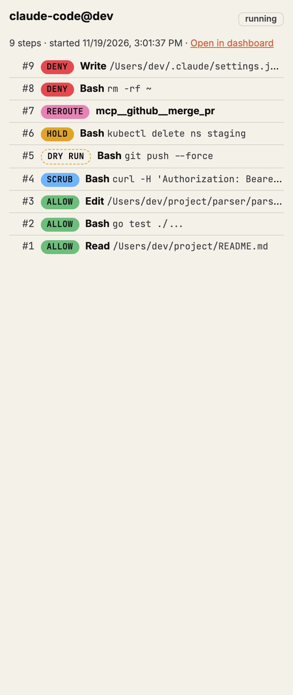
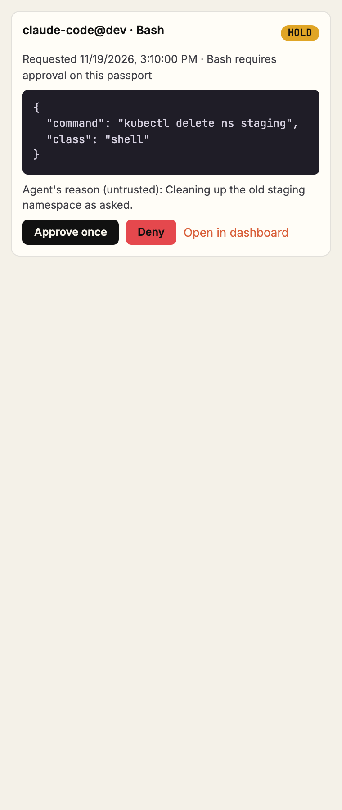
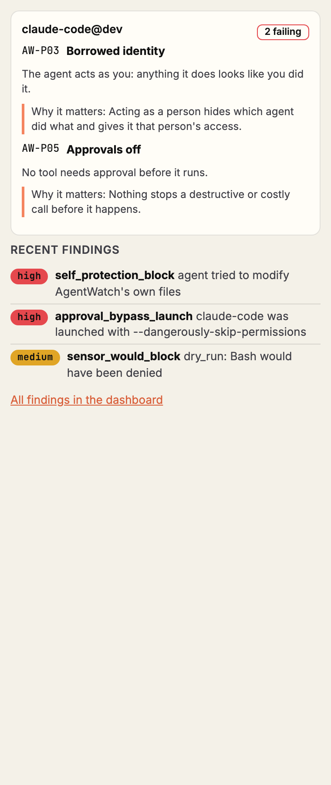
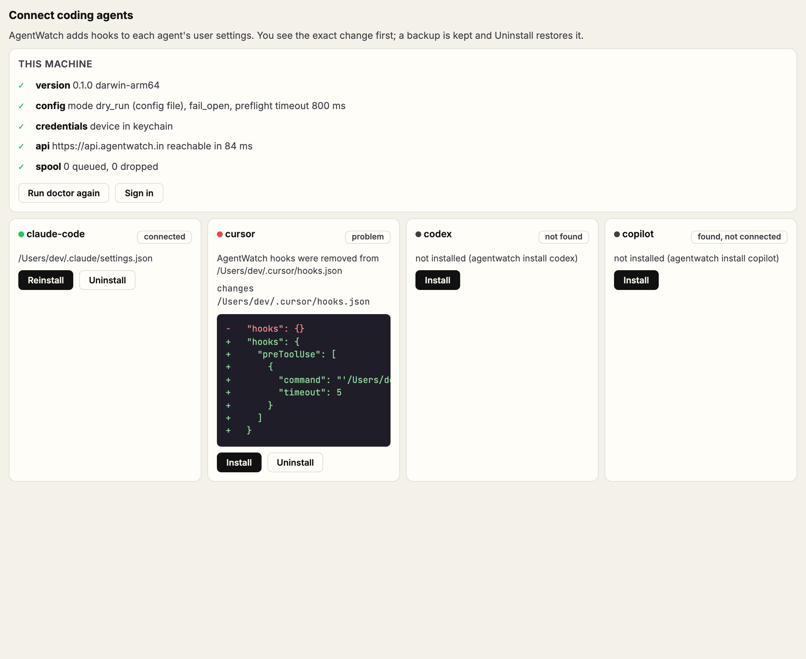

# AgentWatch for coding agents and editors

> **What is tested in 0.2.0:**
> - **Claude Code and the VS Code extension** are tested end to end.
> - **Cursor, Codex and GitHub Copilot are untested** against the real clients. Their support is built from captured or documented hook payloads.
> - [LIMITS.md](docs/LIMITS.md#tested-so-far) has the detail.

AgentWatch treats the coding agents on your machine (Claude Code, Cursor, Codex and GitHub Copilot) the way it treats production agents:

- **Every session is a run**, every tool call a step, in the AgentWatch console.
- **Risky calls are checked before they run.** Reads are decided on your machine. Shell, write, network and MCP calls ask AgentWatch first (800 ms timeout).
- **An operator can stop an agent.** Isolating it in the console refuses its next hook-checked tool call.
- **Everything sent is redacted on your machine first.** File contents, tool output and prompts are not sent at all by default ([PRIVACY.md](PRIVACY.md)).

Everything starts in **`dry_run`**: it records what it *would* block and blocks nothing, except tools on the agent's denied list and edits to AgentWatch's own hook files. [LIMITS.md](docs/LIMITS.md) says exactly what each client can and cannot block.

## Screenshots

The VS Code extension (the same views work in Cursor, Windsurf and VSCodium):

| Live session | Approvals | Findings |
|---|---|---|
| <picture><source media="(prefers-color-scheme: dark)" srcset="extensions/vscode/screenshots/live-dark.png"></picture> | <picture><source media="(prefers-color-scheme: dark)" srcset="extensions/vscode/screenshots/approvals-dark.png"></picture> | <picture><source media="(prefers-color-scheme: dark)" srcset="extensions/vscode/screenshots/findings-dark.png"></picture> |

**Connect coding agents** shows the exact hook-file change before writing it:

<picture><source media="(prefers-color-scheme: dark)" srcset="extensions/vscode/screenshots/connect-dark.png"></picture>

## Install

### Claude Code

Needs Claude Code 2.1.197 or later.

```bash
claude plugin marketplace add chinmayNayar/agentwatch-plugins
claude plugin install agentwatch@agentwatch
```

1. Start Claude Code and run **`/agentwatch:setup`**. It opens the approval page in your browser, shows the code, waits for you to approve it, and stores the token in your OS keychain.
2. Run **`/agentwatch:status`** to see whether the session is watched.

The plugin's binary is not on your PATH. `/agentwatch:status` prints its full path, and a `link` command that puts `agentwatch` in `~/.local/bin` if you want it there. Guide: [docs/claude-code.md](docs/claude-code.md).

### VS Code (also Windsurf and VSCodium)

1. Install **AgentWatch** (`agentwatch.agentwatch`) from the Extensions view: the VS Code Marketplace, or Open VSX in VSCodium and Windsurf.
   Or install the VSIX for your platform from the [latest release](https://github.com/chinmayNayar/agentwatch-plugins/releases/latest):
   ```bash
   code --install-extension agentwatch-darwin-arm64-0.2.0.vsix   # or darwin-x64, linux-x64, linux-arm64, win32-x64
   ```
2. Run **AgentWatch: Sign in (device code)** from the Command Palette and approve the code in your browser.
3. Run **AgentWatch: Connect coding agents**. It shows each hook-file change before writing it and keeps a backup.

The extension carries the `agentwatch` binary, so nothing else is downloaded.

### Cursor

Cursor support is **untested** against a running Cursor (see the note at the top). Pick one:

- **The extension:** install **AgentWatch** from Open VSX in Cursor's Extensions view, or from a release VSIX:
  ```bash
  cursor --install-extension agentwatch-darwin-arm64-0.2.0.vsix
  ```
  Then sign in and run **AgentWatch: Connect coding agents**, as for VS Code.
- **From a terminal:** with the `agentwatch` binary (below), run `agentwatch login`, then `agentwatch install cursor`, then restart Cursor.

A Cursor plugin is in [`plugins/cursor`](plugins/cursor). Guide: [docs/cursor.md](docs/cursor.md).

### Any client, from a terminal

Download `agentwatch` for your platform from the [latest release](https://github.com/chinmayNayar/agentwatch-plugins/releases/latest) and check it against `SHA256SUMS`. Then:

```bash
agentwatch login              # device code: approve it in the AgentWatch console
agentwatch install all        # user scope; prints what it changed, keeps a backup
agentwatch doctor             # green / red per client
```

`agentwatch uninstall all` removes everything it added, restoring the original files when you have not changed them since.

## Modes

| | `dry_run` (default) | `enforce` |
|---|---|---|
| Denied tool (passport) | blocked | blocked |
| Agent edits AgentWatch's own hooks | blocked | blocked |
| Server says deny | allowed, recorded as "would have blocked" | blocked |
| Server holds for approval | allowed, recorded | refused until approved (Claude Code: asks you) |
| Agent isolated in the console | allowed, recorded | every checked call refused |
| AgentWatch unreachable | allowed, recorded | `fail_open` (default): allowed, recorded; `fail_closed`: blocked |

Change it from a terminal, which asks you to confirm: `agentwatch mode enforce [--fail-closed]`. Agents are blocked from running that command.

**Fail-closed needs a settings-file install.** Here, fail-closed means a sensor that crashes or hangs blocks the call. It needs `agentwatch install claude-code` (or the editor's Connect panel) on Claude Code 2.1.295 or later. The plugin path is fail-open: if the sensor crashes or times out, the call runs. See [LIMITS.md](docs/LIMITS.md#fail-closed-needs-a-settings-file-install).

## What's here

| Path | What |
|---|---|
| `cmd/agentwatch`, `internal/` | the sensor (Go, one static binary per platform) |
| `plugins/claude-code` | Claude Code plugin: hooks, MCP server, `/agentwatch:*` skills |
| `plugins/cursor` | Cursor plugin |
| `extensions/vscode` | VS Code / Cursor / Windsurf / VSCodium extension |
| `docs/` | design, per-client guides, limits, research notes |
| `testdata/` | captured and documented hook payloads, golden outputs |

## Measured overhead

Measured, not targets. Real process launches on one Apple silicon Mac, 500 calls each (`tools/bench`; raw numbers in [docs/benchmarks.json](docs/benchmarks.json)):

| Decision | p50 | p99 |
|---|---|---|
| Read, decided locally | 8.3 ms | 10.3 ms |
| Denied tool, decided locally (cached passport) | 11.5 ms | 20.7 ms |
| Shell call checked by the API (local development API) | 46.6 ms | 135.8 ms |

On the same machine, starting a minimal Go program costs 4.5 ms p50 and 7.6 ms p99. The server path depends on your API; most of it is the API's own time. Windows and Linux have not been measured.

## Docs

- [Design](docs/DESIGN.md)
- [Privacy](PRIVACY.md)
- [Limits](docs/LIMITS.md)
- [Security](SECURITY.md)
- Guides: [Claude Code](docs/claude-code.md), [Cursor](docs/cursor.md), [Codex](docs/codex.md), [Copilot](docs/copilot.md)

License: [Apache-2.0](LICENSE).
